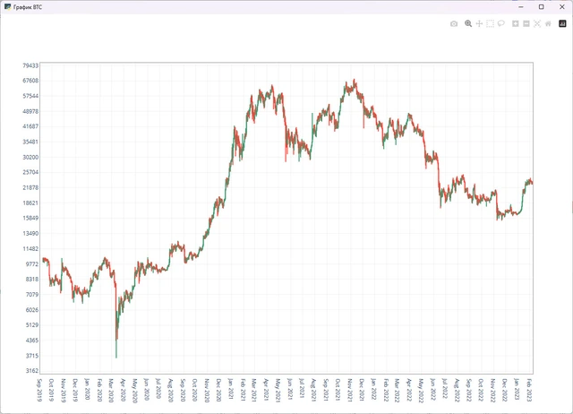

# neuronet_tkinter

Приложение на CustomTkinter для графиков Bitcoin: свечи, линии, логарифмический режим, масштабирование и перемещение.

**Python-портфолио Евгения Толмачева** · Начало: 2023 · Python · CustomTkinter · pandas · Tkinter Canvas



## Возможности

- Настольный интерфейс для работы с графиками.
- Переключение свечного и линейного представления.
- Логарифмический масштаб и управление областью просмотра.

## Что смотреть в коде

Собственная отрисовка графика, масштабирование, перемещение и смена представления данных в CustomTkinter.

Начните с `neuronet_tkinter.py`. Названия авторских файлов и их расположение сохранены.

## Структура

```text
neuronet_tkinter/
├── docs/
│   └── preview.webp
├── .gitignore
├── change_data.py
├── change_data_line.py
├── change_data_log.py
├── change_data_log_line.py
├── neuronet_tkinter.py
├── README.md
├── README.public.md
└── requirements.txt
```

## Подготовка и запуск

Это сохранённая версия пет-проекта, показывающая этап развития навыков. Для воспроизведения создайте отдельное окружение Python, совместимое с зафиксированными зависимостями:

```powershell
python -m venv .venv
.venv\Scripts\Activate.ps1
python -m pip install -r requirements.txt
```

Нужен dataframe.pkl. Несмотря на историческое название, основной предмет этой версии - интерфейс и графики, а не обучение нейросети.

После подготовки настроек и необходимых данных основная точка входа:

```powershell
python neuronet_tkinter.py
```

`requirements.txt` сохранён из проекта. Это снимок окружения, а не гарантия совместимости с новейшей версией Python. Для старых проектов могут потребоваться соответствующая версия Python и настройка системных компонентов.

## История и состав публикации

В таблице - февраль 2023 по дате примера. Код версии - март и октябрь 2023. Название папки сохранено; в этой версии показано приложение для графиков.

В репозитории оставлены авторские исходники, зависимости и один компактный скриншот. Виртуальные окружения, сторонние библиотеки, рабочие базы, модели, большие наборы данных и персональные настройки не включены.

Чувствительные значения заменены понятными заглушками `YOUR_...` / `REDACTED_...`. Настоящие доступы не следует добавлять в Git. Алгоритмы и структура проекта при подготовке публикации не перерабатывались.

Проверена синтаксическая корректность Python-файлов и выполнено сканирование публикуемой копии на секреты. Полный запуск с внешними API, платежами, биржевыми операциями и локальными моделями не выполнялся.

Автор: [Евгений Толмачев](https://github.com/EvgenyET) · [Портфолио](https://evgeny.tech/)
